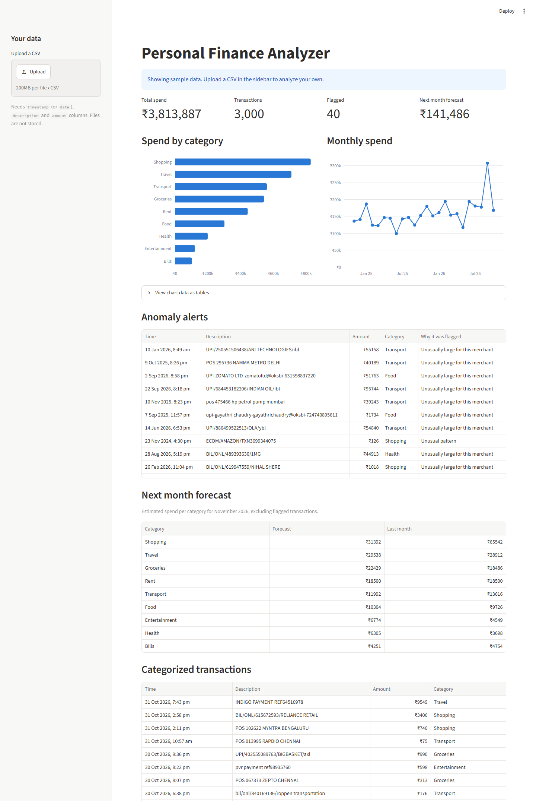
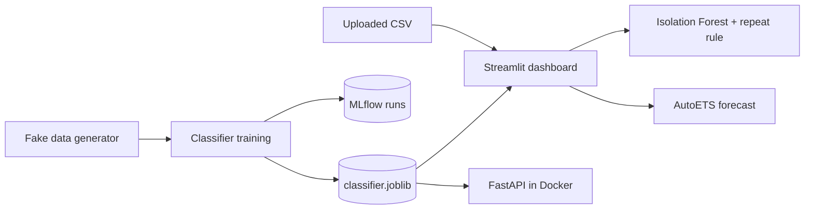

# Personal Finance Analyzer

[](https://github.com/venki-200406/Finance/actions/workflows/ci.yml)

Bank statements are hard to read. Descriptions look like `UPI/SWIGGY*ORDER/8823`, double charges are easy to miss, and most people only learn what they spent after the month is over. This project categorizes transactions, flags the suspicious ones and forecasts next month's spend per category.

**Live demo:** _link added after deployment_



All data in this project is synthetic, so no real bank data is involved. The metrics below describe performance on that generated data.

## What it does

- **Categorizes** messy Indian bank descriptions into 9 spending categories.
- **Flags anomalies** such as huge charges, duplicate charges and late-night payments, and says why each one was flagged.
- **Forecasts** next month's spend per category.
- **Serves** the classifier through a FastAPI endpoint packaged in Docker.
- **Protects quality** with a GitHub Actions gate that fails if macro-F1 drops below 0.85.

## Architecture



## Results

| Component | Method | Result |
|---|---|---|
| Classifier | Character TF-IDF + Logistic Regression | 0.928 macro-F1 on a 600-row held-out test set |
| Anomaly detector | Isolation Forest + repeat-charge rule | 73% recall, 55% precision on 30 injected anomalies |
| Forecast | AutoETS, 6-month rolling backtest | Mean error ₹4,902 per category, against ₹6,347 for "same as last month" |

**Classifier.** Four configurations were tracked in MLflow, and the winner was chosen by 5-fold cross-validation so the test score stays an honest estimate. Groceries (0.83) and Shopping (0.86) score lowest because merchants like Amazon appear under both, as they do on real statements.

| Run | Cross-validation macro-F1 | Test macro-F1 |
|---|---|---|
| Logistic Regression, character n-grams (selected) | 0.924 | 0.928 |
| LinearSVC, character n-grams | 0.921 | 0.930 |
| Logistic Regression, word n-grams | 0.901 | 0.905 |
| LinearSVC, word n-grams | 0.899 | 0.902 |

**Anomaly detector.** Recall by type is 100% for duplicates, 90% for huge amounts and 30% for night charges. Total recall ranged from 73% to 97% across three data seeds, and the table reports the lowest, which is also the project's default seed. Isolation Forest alone caught only about 30%, because large regular payments like rent looked more unusual than real anomalies. Comparing each amount with that merchant's typical charge fixed that, and exact repeats are handled by a simple rule, since a duplicate looks statistically normal.

**Forecast.** AutoETS beats the baseline overall and in 5 of 9 categories (Rent ties at zero error). It loses on Entertainment, Groceries and Shopping. Two years of data is too short to model yearly seasonality, so festival spikes such as Diwali are not predicted.

## Run it

Requires Python 3.12. On macOS or Linux, activate with `source .venv/bin/activate`.

```powershell
python -m venv .venv
.\.venv\Scripts\activate
python -m pip install -r requirements-dev.txt

python -m src.generate_data
python -m src.train_classifier
python -m src.anomaly
python -m src.forecast
python -m pytest

streamlit run app/streamlit_app.py
```

To compare the experiments, run `mlflow ui --backend-store-uri sqlite:///mlflow.db`.

To analyze your own transactions, upload a CSV with `timestamp` (or `date`), `description` and `amount` columns. Forecasts need at least 6 complete months.

### API

```powershell
docker build -t finance-analyzer-api .
docker run --rm -p 8000:8000 finance-analyzer-api
```

```bash
curl -X POST http://localhost:8000/categorize \
  -H "Content-Type: application/json" \
  -d '{"description": "UPI/SWIGGY*ORDER/8823"}'
# {"category":"Food"}
```

`GET /health` returns `{"status":"ok"}`.

## Project layout

```text
src/generate_data.py     Synthetic transactions with labelled anomalies
src/train_classifier.py  Model comparison and MLflow tracking
src/anomaly.py           Isolation Forest and repeat-charge rule
src/forecast.py          Monthly forecast and backtest
src/predict.py           Shared cleaning, validation and model loading
app/streamlit_app.py     Dashboard
api/main.py              FastAPI service
tests/test_model.py      Model and quality-gate tests
```

## Limitations and next steps

- The model has only seen generated data, so accuracy on real statements will differ.
- The CI gate checks a fixed 0.85 threshold, so it does not compare against the previous model.
- Next: parse real bank PDFs, try sentence embeddings, add data versioning, and retrain from user corrections.
